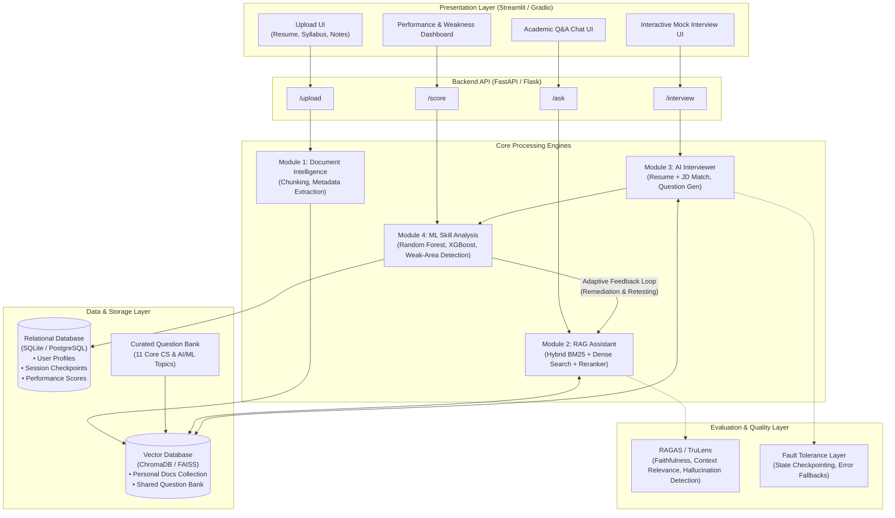
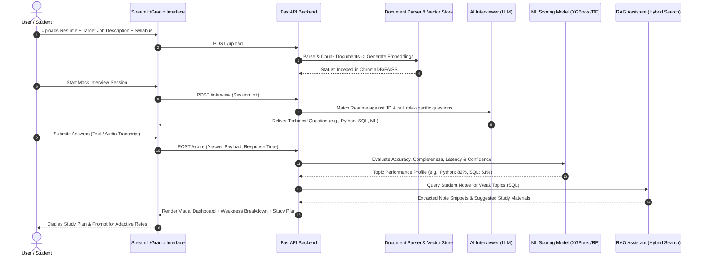

# Intelligent Academic & Career Copilot (RAG + ML)

[](#project-roadmap)
[](https://www.python.org/)
[](#technology-stack)
[](#module-2-rag-assistant)
[](#evaluation--quality-assurance)

An end-to-end academic and career acceleration platform combining **Retrieval-Augmented Generation (RAG)** and **Supervised Machine Learning**. The system ingests student course materials and resumes, generates tailored mock interviews aligned with industry job descriptions, diagnoses granular topic-level weaknesses using predictive ML, and closes the learning gap through an adaptive recommendation loop linked back to student notes.

---

## Metadata & Academic Details

| Attribute | Details |
| :--- | :--- |
| **Project Code** | **PR1107** (Major Project) |
| **Institution** | Institute of Engineering and Technology (IET), JK Lakshmipat University (JKLU) |
| **Faculty Guide** | **Devendra Bhavsar** |
| **Team Members** | • **Nakul Ranka** (`2023Btech050`)<br>• **Prateek Goswami** (`2023Btech058`)<br>• **Siddharth Ranka** (`2023Btech082`) |
| **Synopsis Date** | August 14, 2026 |
| **Current Milestone**| Week 1 Completed (Architecture, Data Pipeline Design & Schema Finalized) |

---

## Table of Contents

- [Intelligent Academic \& Career Copilot (RAG + ML)](#intelligent-academic--career-copilot-rag--ml)
  - [Metadata \& Academic Details](#metadata--academic-details)
  - [Table of Contents](#table-of-contents)
  - [Project Overview \& Problem Statement](#project-overview--problem-statement)
    - [The Problem](#the-problem)
    - [The Proposed Solution](#the-proposed-solution)
  - [Key Features](#key-features)
  - [System Architecture](#system-architecture)
    - [High-Level Architectural Flow](#high-level-architectural-flow)
    - [Detailed Data \& Component Flowchart](#detailed-data--component-flowchart)
  - [Core Modules Breakdown](#core-modules-breakdown)
    - [Module 1: Document Intelligence](#module-1-document-intelligence)
    - [Module 2: RAG Assistant (Hybrid Retrieval + Reranking)](#module-2-rag-assistant-hybrid-retrieval--reranking)
    - [Module 3: AI Interviewer \& Industry Knowledge Base](#module-3-ai-interviewer--industry-knowledge-base)
    - [Module 4: ML-Based Skill Analysis \& Adaptive Learning Loop](#module-4-ml-based-skill-analysis--adaptive-learning-loop)
  - [Evaluation \& Quality Assurance](#evaluation--quality-assurance)
  - [Fault Tolerance \& Reliability](#fault-tolerance--reliability)
  - [Technology Stack](#technology-stack)
  - [Project Repository Structure](#project-repository-structure)
  - [API Specification (Draft)](#api-specification-draft)
  - [Local Setup \& Installation](#local-setup--installation)
    - [Prerequisites](#prerequisites)
    - [Step-by-Step Setup](#step-by-step-setup)
    - [Environment Variables Configuration (`.env`)](#environment-variables-configuration-env)
    - [Running the Applications](#running-the-applications)
  - [Project Roadmap \& Milestones](#project-roadmap--milestones)
  - [Academic References](#academic-references)

---

## Project Overview & Problem Statement

### The Problem
Preparing for academic examinations and technical job interviews presents major friction points for engineering students:
1. **No Curricular Grounding**: Generic chatbots lack alignment with specific course syllabi, university exam patterns, and target job descriptions (JDs).
2. **One-Way Interaction**: Current study assistants answer queries statically without assessing whether the student actually internalized the concepts or retained prerequisite knowledge.
3. **No Closed-Loop Feedback**: Students rarely receive automated, quantitative diagnosis of their topic-level weak points (e.g., scoring 82% in Python, but 61% in SQL & Databases), nor a direct path back to relevant lecture notes.

### The Proposed Solution
The **Intelligent Academic & Career Copilot** introduces a closed-loop preparation engine:
1. Ingests user documents (syllabi, lecture notes, exam papers, and resumes).
2. Conducts adaptive AI audio interviews and timed MCQ mock exams backed by a curated 11-topic interview question bank.
3. Analyzes candidate responses using Whisper speech-to-text, deterministic fluency checks, and LLM evaluation across rubric dimensions.
4. Highlights weak sub-domains linked back to the student's uploaded course notes.

---

## Key Features

- 📄 **Multi-Format Document Parsing**: Native extraction of syllabi, resumes, lecture presentations, and question papers (`.pdf`, `.docx`, `.pptx`, `.txt`).
- 🔍 **Hybrid RAG Pipeline**: Combines sparse lexical matching (**BM25**) with dense semantic vector embeddings (**Sentence-Transformers**) and a neural cross-encoder **Reranker** to minimize context noise.
- 🎯 **Dossier-Calibrated Mock Interviews**: Parses student resumes alongside target Job Descriptions (extracting role, organization, and skill gaps) to drive Audio and MCQ mock interviews.
- 📊 **ATS & Topic Diagnostics**: Evaluates resume-to-JD ATS compatibility, MCQ topic proficiency, and audio interview performance charts.
- 🛡️ **Reliability & Hallucination Guard**: Automated groundedness checking (TruLens/RAGAS) and stateful SQLite session recovery.

---

## System Architecture

### High-Level Architectural Flow



### Detailed Data & Component Flowchart



---

## Core Modules Breakdown

### Module 1: Document Intelligence
- **Responsibilities**:
  - Ingestion of heterogeneous files: PDF course packs, DOCX assignments, PPT/PPTX slide decks, markdown notes, text syllabi, and resumes.
  - Structure-aware chunking: Splits academic text based on headings, lecture slides, sections, and questions rather than arbitrary token boundaries.
  - Metadata enrichment: Tags chunks with source filename, section, course module, and document category (`syllabus`, `lecture_note`, `exam_paper`, `resume`).

### Module 2: RAG Assistant (Hybrid Retrieval + Reranking)
- **Hybrid Retrieval Architecture**:
  - **Lexical Search (BM25)**: Ensures exact keyword retrieval for technical acronyms, algorithms (e.g., "PCA", "Dijkstra", "Backpropagation"), and equation names.
  - **Dense Vector Search**: Powered by `Sentence-Transformers` (`all-MiniLM-L6-v2` or `bge-small-en-v1.5`) stored in ChromaDB/FAISS for semantic intent matching.
  - **Reciprocal Rank Fusion (RRF) / Cross-Encoder Reranker**: Re-orders candidate chunks to maximize precision before prompt injection.
- **Generation & LLM Support**:
  - Supports open-weight LLMs including **Mistral-7B-Instruct** and **Llama-3-8B-Instruct** running locally (Ollama / vLLM) or via the Hugging Face Inference API.
  - Orchestration handled by **LlamaIndex** / **LangChain**.

### Module 3: AI Interviewer & Industry Knowledge Base
- **Role Profiling**:
  - Parses uploaded resume and target Job Description (e.g., Machine Learning Engineer, Data Analyst, Software Engineer).
  - Performs skill-gap alignment mapping between candidate background and job prerequisites.
- **Shared Industry Question Bank**:
  - Curated, deduplicated 11-topic repository aligned to core CS/AI/ML coursework and Behavioral/HR interviews.
  - Filters strictly by Topic, Interview Round (`Coding`, `Technical`, `HR`), and Difficulty (`easy`, `medium`, `hard`).

### Module 4: ML-Based Skill Analysis & Adaptive Learning Loop
- **Predictive Scoring**:
  - Evaluates student response characteristics: semantic accuracy against reference knowledge, conceptual coverage, response time, and vocabulary confidence.
  - Supervised ML models (Random Forest, XGBoost) classify readiness levels and output granular topic-level percentages (e.g., Python: 82%, Deep Learning: 74%, SQL: 61%).
- **Adaptive Remediation Engine**:
  - Translates diagnosed weak areas into focused RAG queries against the student's personal notes and official course syllabus.
  - Assembles custom micro-study guides emphasizing the exact topics requiring revision.
  - Triggers automated retesting with targeted questions to verify concept mastery.

---

## Evaluation & Quality Assurance

To ensure the assistant provides reliable, factual, and hallucination-free guidance, the RAG and interview pipelines are evaluated using standard LLM evaluation frameworks:

| Metric Category | Metric Name | Target Benchmark | Measurement Tool |
| :--- | :--- | :--- | :--- |
| **Retrieval Quality** | Context Precision | $> 0.85$ | RAGAS |
| **Retrieval Quality** | Context Recall | $> 0.80$ | RAGAS |
| **Generation Quality**| Faithfulness (Groundedness) | $> 0.90$ (Zero hallucination) | RAGAS / TruLens |
| **Generation Quality**| Answer Relevance | $> 0.85$ | RAGAS |
| **ML Scoring** | Skill Prediction Accuracy | $\text{RMSE} < 0.12$ / $F_1 > 0.82$ | Scikit-Learn Metrics |

---

## Fault Tolerance & Reliability

The application implements enterprise-grade resilience mechanisms for long interview sessions and large document uploads:

- **State Checkpointing**: Interview sessions are serialized after each response. If network disconnection occurs, the user resumes from the exact question without losing score history.
- **Multi-Tier Fallbacks**:
  - *Vector Search Failure*: Degrades gracefully to BM25 keyword search if the vector index is unreachable.
  - *Inference API Failure*: Automatically switches between primary LLM provider (e.g., Hugging Face Inference API) and local fallback instances (e.g., local quantized Mistral/Llama via Ollama).
- **Graceful Degradation**: If document parsing encounters corrupted PDF pages or unreadable slides, the system isolates faulty pages, logs a warning, and indexes valid content without terminating the batch.
- **Hallucination Detection Guard**: Queries yielding low context similarity are rejected with explicit guidance rather than allowing the LLM to invent unsupported facts.

---

## Technology Stack

```
├── Backend API:            Python 3.10+, FastAPI / Flask
├── Frontend Application:   Streamlit / Gradio
├── Embeddings:             Sentence-Transformers (all-MiniLM-L6-v2 / BAAI/bge-small-en-v1.5)
├── Vector Storage:         FAISS / ChromaDB
├── Hybrid Search:          Rank-BM25 + Dense Cosine Similarity + Cross-Encoder Reranker
├── LLM Inference:          Mistral-7B-Instruct / Llama-3-8B-Instruct (Local / Hugging Face API)
├── Orchestration:          LlamaIndex / LangChain
├── Machine Learning:       Scikit-Learn (RandomForest, Logistic Regression), XGBoost
├── Evaluation:             RAGAS, TruLens
└── Deployment Target:      Hugging Face Spaces / Render (Free Tier) / Docker
```

---

## Project Repository Structure

```
Major_Project/
├── README.md                           # Master project documentation (this file)
├── requirements.txt                    # Python dependencies
├── .env.example                        # Template environment variables
├── data/
│   ├── raw_documents/                  # Uploaded user syllabi, notes, resumes
│   ├── processed_chunks/               # Serialized text chunks and metadata
│   ├── question_bank/                  # Curated 11-topic interview question bank JSON
│   └── vector_store/                   # Persistent ChromaDB / FAISS index storage
├── src/
│   ├── __init__.py
│   ├── api/                            # FastAPI backend service
│   │   ├── __init__.py
│   │   ├── main.py                     # API router entry point
│   │   └── routes/
│   │       ├── upload.py               # Document ingestion endpoint
│   │       ├── ask.py                  # RAG Q&A endpoint
│   │       ├── audio_interview.py      # Adaptive AI Audio Interview endpoints
│   │       ├── mcq_interview.py        # Timed MCQ Examination endpoints
│   │       ├── questions.py            # Question Bank endpoints
│   │       └── score.py                # ATS resume audit endpoint
│   ├── document_intelligence/          # Module 1: Parsing & Chunking
│   │   ├── __init__.py
│   │   ├── parser.py                   # PDF, DOCX, PPTX extractors
│   │   └── chunker.py                  # Syllabus & slide-aware text splitters
│   ├── rag_assistant/                  # Module 2: Hybrid RAG Engine
│   │   ├── __init__.py
│   │   ├── embeddings.py               # Sentence-Transformers wrapper
│   │   ├── hybrid_retriever.py         # BM25 + Vector Search + Reranker
│   │   └── generator.py                # LLM prompt manager & responder
│   ├── interviewer/                    # Module 3: Interviewer & Question Bank
│   │   ├── __init__.py
│   │   ├── role_matcher.py             # Resume-to-JD skill extractor
│   │   ├── audio_service.py            # Whisper STT & fluency analyzer
│   │   ├── audio_interviewer.py        # Adaptive LLM interview orchestrator
│   │   ├── mcq_generator.py            # Timed MCQ generator
│   │   ├── question_bank_service.py    # Question search & bookmark service
│   │   ├── ingestion.py                # Deduplication & ingestion pipeline
│   │   └── scraper_pipeline.py         # Question bank updater & seeder
│   ├── ml_scoring/                     # Module 4: ATS Resume Diagnostics
│   │   ├── __init__.py
│   │   └── ats_scorer.py               # Resume-vs-JD ATS compatibility scoring
│   └── utils/
│       ├── checkpoint.py               # SQLite session persistence
│       └── logger.py                   # Structured error logging
├── evaluation/                         # Benchmarking & Validation
│   ├── eval_ragas.py                   # RAGAS metrics execution
│   └── eval_trulens.py                 # Groundedness & hallucination test suites
├── tests/                              # Unit and integration test suites
│   ├── test_parser.py
│   ├── test_rag.py
│   ├── test_email_otp.py
│   ├── test_question_bank_integration.py
│   └── test_audio_interview_adaptive.py
└── ui/                                 # Streamlit frontend presentation
    ├── app.py                          # Streamlit navigation entry point
    ├── views/
    │   ├── upload_view.py              # File upload interface
    │   ├── chat_view.py                # RAG Study Q&A interface
    │   ├── interview_view.py           # Mock interview interactive session
    │   └── dashboard_view.py           # Skill analytics & study plan view
```

---

## API Specification (Draft)

### 1. Document Ingestion
- **Route**: `POST /api/v1/upload`
- **Payload**: `multipart/form-data` (`file`, `doc_type`: `syllabus|notes|resume|exam`)
- **Response**:
```json
{
  "status": "success",
  "document_id": "doc_8f9a2b",
  "filename": "Machine_Learning_Syllabus.pdf",
  "chunks_indexed": 42,
  "vector_collection": "user_personal_docs"
}
```

### 2. Academic Q&A (RAG Assistant)
- **Route**: `POST /api/v1/ask`
- **Payload**:
```json
{
  "query": "Explain Principal Component Analysis and its assumptions.",
  "collection_filter": "syllabus",
  "top_k": 3
}
```
- **Response**:
```json
{
  "answer": "Principal Component Analysis (PCA) is an unsupervised dimensionality reduction technique...",
  "sources": [
    {
      "document": "Unit_3_Unsupervised_Learning.pdf",
      "page": 14,
      "relevance_score": 0.93
    }
  ]
}
```

### 3. AI Audio Interview & Timed MCQ Battery
- **Audio Routes**: `POST /api/v1/audio-interview/start`, `POST /api/v1/audio-interview/{id}/transcribe`, `POST /api/v1/audio-interview/{id}/submit-turn`, `POST /api/v1/audio-interview/{id}/end`
- **MCQ Routes**: `POST /api/v1/mcq/start`, `POST /api/v1/mcq/answer`, `GET /api/v1/mcq/latest`

### 4. ATS Resume Compatibility Audit
- **Route**: `GET /api/v1/score/ats/analyze`
- Evaluates keyword coverage, resume sections, action verbs, and quantified impact against the uploaded job description.

---

## Local Setup & Installation

### Prerequisites
- Python **3.10** or higher
- Git
- Virtual environment manager (`venv` or `conda`)
- Optional: CUDA-compatible GPU for accelerated local embeddings/LLM inference

### Step-by-Step Setup

1. **Clone the Repository**:
   ```bash
   git clone https://github.com/your-username/Major_Project.git
   cd Major_Project
   ```

2. **Create and Activate a Virtual Environment**:
   ```bash
   # Windows (PowerShell)
   python -m venv venv
   .\venv\Scripts\Activate.ps1

   # Linux / macOS
   python3 -m venv venv
   source venv/bin/activate
   ```

3. **Install Dependencies**:
   ```bash
   pip install --upgrade pip
   pip install -r requirements.txt
   ```

### Environment Variables Configuration (`.env`)
Copy `.env.example` to `.env` and configure the following sections:
```ini
# Core Configuration
ENVIRONMENT=development
DEBUG=True
LOG_LEVEL=INFO

# LLM & Speech-to-Text (Groq + Hugging Face Fallback)
LLM_PROVIDER=groq
GROQ_API_KEY=your_groq_api_key_here
GROQ_MODEL=openai/gpt-oss-120b
GROQ_FALLBACK_MODEL=openai/gpt-oss-20b
STT_MODEL=whisper-large-v3-turbo
HF_API_TOKEN=your_huggingface_token_here
EMBEDDING_MODEL=sentence-transformers/all-MiniLM-L6-v2

# Storage & Audio Retention
CHROMA_PERSIST_DIR=./data/vector_store/chroma
SQLITE_DB_PATH=./data/copilot_app.db
AUDIO_STORAGE_DIR=./data/audio_recordings
AUDIO_RETENTION_HOURS=24

# Email OTP Security & SMTP
OTP_MODE=email                          # Use 'console' for local dev without SMTP
OTP_HMAC_SECRET=change_this_secret
SMTP_HOST=smtp.gmail.com
SMTP_PORT=587
SMTP_USERNAME=your_email@gmail.com
SMTP_PASSWORD=your_16_char_app_password
SMTP_FROM_EMAIL=your_email@gmail.com
SMTP_FROM_NAME=Academic & Career Copilot

# Question Sources
SCRAPE_ENABLED=True
SCRAPE_RATE_LIMIT_SECONDS=3
```

### Email SMTP Configuration (Gmail / Transactional SMTP)
1. Enable **2-Step Verification** on your Google account.
2. Generate a 16-character **App Password** at `https://myaccount.google.com/apppasswords`.
3. Set `OTP_MODE=email`, `SMTP_USERNAME`, `SMTP_PASSWORD` (the App Password), and `SMTP_FROM_EMAIL` in `.env`.
4. For local development without an SMTP server, set `OTP_MODE=console` to view verification codes in the FastAPI server terminal.

### Running the Applications

1. **Start the FastAPI Backend Service**:
   ```bash
   python -m uvicorn src.api.main:app --host 127.0.0.1 --port 8000 --reload
   ```
   *Swagger API Documentation will be accessible at: `http://127.0.0.1:8000/docs`*

2. **Start the Streamlit User Interface**:
   ```bash
   python -m streamlit run ui/app.py
   ```
   *Frontend UI will open automatically at: `http://localhost:8501`*

### New Integrated Modules & API Endpoints

- **Secure Email OTP Authentication (`/api/v1/auth/*`)**:
  - `POST /api/v1/auth/signup`, `POST /api/v1/auth/verify-signup`, `POST /api/v1/auth/signin`, `POST /api/v1/auth/request-otp`, `POST /api/v1/auth/verify-otp`, `POST /api/v1/auth/forgot-password`, `POST /api/v1/auth/verify-reset-otp`, `POST /api/v1/auth/reset-password`, `POST /api/v1/auth/logout`, `GET /api/v1/auth/me`.
- **Centralized Multi-Topic Question Bank (`/api/v1/questions/*` & `/api/v1/scraping/*`)**:
  - Built via `scripts/build_question_bank.py` (`OpenDatasetsSource`, 5-level exact/lexical/semantic deduplication, 11 fixed topics aligned to `project.tex`).
  - Endpoints: `GET /api/v1/questions/search`, `GET /api/v1/questions/topics`, `GET /api/v1/questions/filters`, `POST/DELETE /api/v1/questions/{id}/bookmark`, `GET /api/v1/questions/bookmarks`, `GET /api/v1/questions/duplicates`, `POST /api/v1/questions/import`, `POST /api/v1/scraping/seed`.
- **Adaptive AI Audio Interview (`/api/v1/audio-interview/*`)**:
  - Built on the BeFluent foundation (`whisper-large-v3-turbo` STT, deterministic fluency metrics, Pydantic-validated Groq LLM adaptive evaluator & follow-up orchestrator).
  - Endpoints: `POST /api/v1/audio-interview/start`, `POST /api/v1/audio-interview/{id}/transcribe`, `POST /api/v1/audio-interview/{id}/submit-turn`, `POST /api/v1/audio-interview/{id}/submit-audio`, `GET /api/v1/audio-interview/{id}`, `POST /api/v1/audio-interview/{id}/end`, `GET /api/v1/audio-interview/{id}/report`, `GET /api/v1/audio-interview/{id}/audio/{turn}`, `GET /api/v1/audio-interview/history`.

### Running Tests
```bash
python -m pytest tests -v
```

### Deployment Instructions
1. Provision Python 3.10+ runtime with `pip install -r requirements.txt`.
2. Configure production `.env` secrets (`GROQ_API_KEY`, `OTP_HMAC_SECRET`, SMTP credentials, `ADMIN_PASSWORD`).
3. Ensure `./data/` is mounted on persistent disk so SQLite (`copilot_app.db`), ChromaDB (`vector_store/`), and retained audio recordings persist across restarts.
4. Run FastAPI behind a reverse proxy (HTTPS required in production for browser `MediaRecorder` / microphone access!) and start Streamlit pointing `API URL` to the backend.

---

## Project Roadmap & Milestones

| Timeline | Phase | Deliverables / Status |
| :--- | :--- | :--- |
| **Week 1** *(8 Sep 2026)* | **System Architecture & Data Modeling** | • Finalize 4-module split (Doc Intelligence, RAG, Interviewer, ML).<br>• Map complete user journey.<br>• Finalize hybrid storage design (Personal docs + shared question bank).<br>• Define technology stack. ✅ **Completed** |
| **Week 2** | **Data Collection & Repository Scaffold** | • Gather sample syllabi, question papers, lecture notes, resumes.<br>• Build the curated 11-topic question bank dataset.<br>• Scaffold repository directories, database schemas, and baseline dependencies. ✅ **Completed** |
| **Week 3 - 4** | **Document Intelligence & Hybrid RAG Engine** | • Implement multi-format document parser (`.pdf`, `.docx`, `.pptx`).<br>• Configure BM25 + ChromaDB/FAISS hybrid retriever with reranking.<br>• Integrate Mistral-7B / Llama 3 via LangChain/LlamaIndex. |
| **Week 5 - 6** | **AI Interviewer & Shared Question Bank** | • Implement resume & Job Description skill extraction parser.<br>• Build interactive mock interview state machine.<br>• Implement session checkpointing and fallback mechanisms. |
| **Week 7 - 8** | **Adaptive Audio Interview & ATS Diagnostics** | • Build BeFluent-based Whisper STT + adaptive LLM interviewer & ATS analyzer.<br>• Link weak audio/MCQ topics back to uploaded course packs for remediation. |
| **Week 9 - 10** | **UI Assembly, Evaluation & Deployment** | • Build Streamlit multi-tab interface (Upload, Chat, Interview, Analytics Dashboard).<br>• Run RAGAS and TruLens benchmarks (Context precision, Recall, Faithfulness).<br>• Package Docker container and deploy to Hugging Face Spaces / Render. |

---

## Academic References

1. **Lewis, P. et al. (2020)**. *Retrieval-Augmented Generation for Knowledge-Intensive NLP Tasks*. Advances in Neural Information Processing Systems (NeurIPS). [arXiv:2005.11401](https://arxiv.org/abs/2005.11401)
2. **Reimers, N., & Gurevych, I. (2019)**. *Sentence-BERT: Sentence Embeddings using Siamese BERT-Networks*. In Proceedings of EMNLP-IJCNLP. [arXiv:1908.10084](https://arxiv.org/abs/1908.10084)
3. **Meta AI (2024)**. *Llama 3 Model Card and Architecture*. [Meta Llama 3](https://huggingface.co/meta-llama)
4. **Mistral AI (2023)**. *Mistral 7B*. [Mistral-7B Release](https://huggingface.co/mistralai)
5. **Johnson, J., Douze, M., & Jégou, H. (2021)**. *Billion-Scale Similarity Search with GPUs (FAISS)*. IEEE Transactions on Big Data. [FAISS Repository](https://github.com/facebookresearch/faiss)
6. **Chroma Core Team (2023)**. *Chroma: The AI-native Open-Source Embedding Database*. [ChromaDB](https://github.com/chroma-core/chroma)
7. **Es, S. et al. (2023)**. *RAGAS: Automated Evaluation of Retrieval Augmented Generation*. [RAGAS Repository](https://github.com/explodinggradients/ragas)
